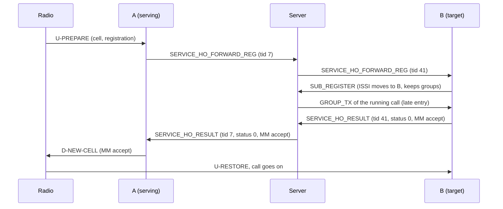
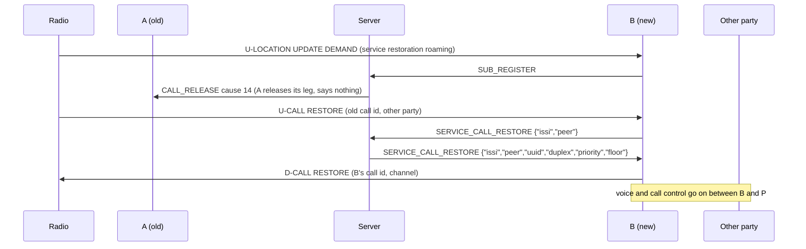

# Brew extensions for cell changes between Basestations

This document specifies the additions to the Brew protocol that let a radio
keep its calls when it moves from one Basestation to another. It is written
for people who build a Brew server or a Basestation other than brew-server
and FlowStation, and is meant to be enough on its own to implement them.
Operator documentation is in [Handover.md](Handover.md).

All additions are optional and negotiated. A server or Basestation that does
not know them never sends or receives any of them, so TetraPack, Brandmeister
and older Basestations keep working unchanged.

References to ETSI are to TS 100 392-2 V3.10.1 (2023-03), the TETRA V+D air
interface. Nothing here changes the air interface: the extensions only carry
what the ETSI procedures on the Basestation need from the other Basestation.

## 1. Terms

| Term | Meaning |
| --- | --- |
| Basestation | A Brew client in Basestation mode (`X-Brew-Mode: Basestation` or no mode header). One Basestation (one WebSocket connection) may serve several cells. |
| Cell | One TETRA cell, identified on the air by network (MCC, MNC), main carrier and band plan, and location area (LA). |
| A, serving / old Basestation | The Basestation the radio is on, or was on. |
| B, target / new Basestation | The Basestation the radio moves to. |
| Announced reselection | The radio tells A first with U-PREPARE (clause 18.3.4.7). Types 1, 2, 3, see clause 18.3.4.7.0. |
| Unannounced reselection | The radio leaves A during a call without telling it and restores the call on B (clause 18.3.4.7.3). |
| Undeclared reselection | As unannounced, without a call (clause 18.3.4.7.2). |
| Late entry | A connection that becomes a participant of a running group call gets the call's `GROUP_TX` and the rest of the over (section 9). |

"Handover" in the extension names is kept for compatibility: TETRA has no
network-controlled handover, the radio decides when it changes cells.

## 2. Base protocol assumed

Everything else is plain Brew as specified in the TETRA Homebrew Protocol:
binary WebSocket messages, first byte the class, second byte the type.
The extensions use:

| Class | Value | Used for |
| --- | --- | --- |
| `CLASS_SUBSCRIBER` | `0xf0` | `SUB_REGISTER` (1), `SUB_REREGISTER` (2), `SUB_DEREGISTER` (0), `SUB_AFFILIATE` (8): unchanged. A registration on B is what moves a radio. |
| `CLASS_CALL_CONTROL` | `0xf1` | `GROUP_TX` (2), `GROUP_IDLE` (3), `CALL_RELEASE` (10) with its cause byte, `SIMPLEX_GRANTED` (12), `SIMPLEX_IDLE` (13): unchanged. |
| `CLASS_SERVICE` | `0xf4` | All new messages, types `0x14` to `0x1D`. `0x10` to `0x13` are taken (RSSI, emergency, blacklist command, blacklist). |

Routing stays as in Brew: one routing entry per ISSI, the newest registration
wins, and a registration keeps the ISSI's group affiliations.

## 3. Negotiation

Two gates, one per direction.

### 3.1 Server offer: `X-Brew-Extensions`

The server adds a response header to the HTTP 101 of a Basestation's
WebSocket upgrade:

```
X-Brew-Extensions: bts-info, handover-v1, ms-cell, ms-moved, ms-reselection, call-restore, cell-directory
```

- Comma separated, names trimmed of spaces, empty names ignored, order
  irrelevant, unknown names ignored by the Basestation.
- Sent only to Basestation-mode connections, on the 101 itself (a
  Basestation without credentials skips the discovery GET, so the GET is not
  enough).
- A Basestation sends an extension message only when the header names its
  extension. No header (TetraPack, Brandmeister, older servers): it sends none.
- A server may offer a subset; each extension below names what it needs.

### 3.2 Basestation capability: `capabilities` in `SERVICE_BTS_INFO`

Some messages go from the server to a Basestation. The server sends them only
to a Basestation that named the capability in its last `SERVICE_BTS_INFO`
(section 5.1), so a Basestation that cannot handle them never gets them.

| Capability | The Basestation | Announce only when the server offered |
| --- | --- | --- |
| `handover-v1` | answers relayed handover requests as target, and grants the floor to a talker that moved to it (section 7.3) | `handover-v1` |
| `ms-moved` | wants `SERVICE_MS_MOVED` | `ms-moved` (FlowStation: together with `handover-v1`) |
| `call-restore` | takes individual calls that move with their radio | `call-restore` (FlowStation: together with `handover-v1`) |
| `cell-directory` | wants `SERVICE_CELL_DIRECTORY` (section 5.3) | `cell-directory` (FlowStation: on its own, also on multi-cell stations) |

### 3.3 Summary

| Type | Name | Direction | Extension offered | Capability needed |
| --- | --- | --- | --- | --- |
| `0x14` | `SERVICE_BTS_INFO` | Basestation → server | `bts-info` | – |
| `0x15` | `SERVICE_HO_PREPARE` | A → server → B | `handover-v1` | A and B: `handover-v1` |
| `0x16` | `SERVICE_HO_FORWARD_REG` | A → server → B | `handover-v1` | A and B: `handover-v1` |
| `0x17` | `SERVICE_HO_RESULT` | B → server → A, or server → A | `handover-v1` | A: `handover-v1` |
| `0x18` | `SERVICE_MS_CELL` | Basestation → server | `ms-cell` | – |
| `0x19` | `SERVICE_MS_MOVED` | server → A | `ms-moved` | A: `ms-moved` |
| `0x1A` | `SERVICE_MS_RESELECTION` | A → server | `ms-reselection` | – |
| `0x1B` | `SERVICE_CALL_RESTORE` | B → server → B | `call-restore` | B: `call-restore` |
| `0x1C` | `SERVICE_CALL_NOT_RESTORED` | B → server | `call-restore` | B: `call-restore` |
| `0x1D` | `SERVICE_CELL_DIRECTORY` | server → Basestation | `cell-directory` | `cell-directory` |

A minimal server can implement `bts-info` and `handover-v1` alone (announced
reselection), and add the others one by one; each is independent except where
noted.

## 4. Framing and common fields

Every new message is

```
0xf4  <type>  <UTF-8 JSON object>  0x00
```

the same as the existing `CLASS_SERVICE` messages. Example, `SERVICE_MS_MOVED`
for ISSI 2320001:

```
f4 19 7b 22 69 73 73 69 22 3a 32 33 32 30 30 30 31 7d 00
      {  "  i  s  s  i  "  :  2  3  2  0  0  0  1  }
```

Rules for all messages:

- Unknown JSON fields are ignored, so later versions can add fields.
- A malformed message (bad JSON, missing required field, value out of range)
  is logged and dropped without an answer. Every exchange has a timeout on
  the side that waits, so a drop is safe.
- Only Basestation-mode connections are heard; the same message from a
  Terminal or Peer connection is ignored.
- Numbers are JSON integers.

| Field | Range | Meaning |
| --- | --- | --- |
| `issi` | 0 to 16777215 (24 bits) | the radio |
| `mcc` | 0 to 1023 | mobile country code |
| `mnc` | 0 to 16383 | mobile network code |
| `carrier` | 0 to 4095 | main carrier number |
| `carrier_ext` | 0 to 1023 | **absolute** band plan of the carrier, see below |
| `location_area` | 0 to 16383 | location area |
| `sdu` + `sdu_len_bits` | hex string + 1 to 4096 | an MM PDU, see below |

**`carrier_ext`** has the layout of the ETSI "main carrier number extension"
(the frequency band, offset, duplex spacing and reverse operation elements):

| Bits | Element |
| --- | --- |
| 9 to 6 | frequency band (4 bits) |
| 5 to 4 | offset: 0 = 0, 1 = +6.25 kHz, 2 = −6.25 kHz, 3 = +12.5 kHz |
| 3 to 1 | duplex spacing (3 bits) |
| 0 | reverse operation |

It is always filled in, never "same as the serving cell": a Basestation whose
neighbour entry has no extension fills in its own band plan. Downlink
frequency = band × 100 MHz + carrier × 25 kHz + offset (clause 21.4.4.1).
Example: band 4, offset 0, duplex spacing 4, normal operation =
`(4 << 6) | (0 << 4) | (4 << 1) | 0` = 264; carrier 1528 is then
438.200 MHz.

**Cell key.** A cell is found network wide by `(mcc, mnc, carrier,
carrier_ext)`, optionally narrowed by `location_area`.

**`sdu`** is the MM PDU exactly as the air interface carries it: lower-case
hex (upper case accepted on input), exactly `ceil(sdu_len_bits / 8)` bytes,
the PDU's first bit in the most significant bit of the first byte, padding
bits at the end of the last byte. `sdu` and `sdu_len_bits` always go
together.

## 5. Cell registry and radio location

### 5.1 `SERVICE_BTS_INFO` (0x14)

Basestation → server, extension `bts-info`. Sent once after every (re)connect
and again whenever the cell configuration changes. Each message replaces the
connection's previous one completely.

```json
{"mcc":232,"mnc":5,
 "cells":[{"cell":0,"carrier":1528,"carrier_ext":264,"location_area":2}],
 "capabilities":["handover-v1","ms-moved","call-restore"]}
```

| Field | Required | Meaning |
| --- | --- | --- |
| `mcc`, `mnc` | yes | the network of all cells of the connection |
| `cells` | yes | 1 to 16 entries, one per cell the connection serves; no carrier twice |
| `cells[].cell` | no | the cell's number within the Basestation (label only, unique in the message); default its position in the list |
| `cells[].carrier`, `cells[].carrier_ext`, `cells[].location_area` | yes | as in section 4 |
| `capabilities` | no | up to 16 strings of 1 to 32 characters (section 3.2); default none |
| `cells[].ms_txpwr_max_dbm` etc. | no | what the cell broadcasts, see 5.1.1 |

#### 5.1.1 Optional cell fields: what the cell broadcasts

A Basestation may add what each cell broadcasts, so other Basestations can
list the cell as a neighbour with the right values (section 5.3). FlowStation
sends them when the server offered `cell-directory`; a server that does not
know them ignores them (unknown fields, section 4).

```json
{"cell":0,"carrier":1528,"carrier_ext":264,"location_area":2,
 "ms_txpwr_max_dbm":30,"rxlev_access_min_dbm":-100,
 "service_details":{"registration":true,"deregistration":true,"priority_cell":false,
   "no_minimum_mode":false,"migration":false,"system_wide_services":true,"voice_service":true,
   "circuit_mode_data_service":false,"sndcp_service":false,"aie_service":false,"advanced_link":false},
 "neighbours":[{"mcc":232,"mnc":5,"carrier":1530,"carrier_ext":264,"location_area":1}]}
```

| Field | Range | Meaning (TS 100 392-2) |
| --- | --- | --- |
| `ms_txpwr_max_dbm` | 15 to 45 in 5 dB steps | MS_TXPWR_MAX_CELL of the cell's SYSINFO: the highest power an MS may use on the cell. Element values 1 to 7 of table 18.57 (value = 10 + 5 × element); element 0 is reserved and never sent. A neighbour entry carries it as "maximum MS transmit power", used by the MS in C2 (clause 23.7.1.2) |
| `rxlev_access_min_dbm` | −125 to −50 in 5 dB steps | RXLEV_ACCESS_MIN of the SYSINFO (table 21.65: element 0 = −125 dBm, each step +5 dB): the lowest level at which an MS may access the cell, reference of C1 / C2. A neighbour entry carries it as "minimum RX access level" |
| `service_details` | object of `true` / `false` | the "BS service details" the cell broadcasts (clause 18.5.2.1, table 18.26), one key per bit, see below |
| `neighbours` | 0 to 7 entries | the neighbour cells the cell broadcasts in D-NWRK-BROADCAST (at most 7, table 18.71), see below |

`service_details` keys, in the bit order of table 18.26 (the reserved bit
between circuit mode data and SNDCP is not sent):

| Key | Bit is 1 when |
| --- | --- |
| `registration` | registration is mandatory on the cell |
| `deregistration` | de-registration is requested on the cell |
| `priority_cell` | the cell is a priority cell |
| `no_minimum_mode` | the cell never uses minimum mode ("minimum mode service" element) |
| `migration` | migration is supported by the cell |
| `system_wide_services` | normal mode, system wide services supported (0 = temporarily not supported) |
| `voice_service` | TETRA voice service is supported |
| `circuit_mode_data_service` | circuit mode data service is supported |
| `sndcp_service` | SNDCP service is available |
| `aie_service` | air interface encryption is available |
| `advanced_link` | advanced link is supported |

Send the bits as the cell broadcasts them at that moment (FlowStation sends
`system_wide_services` true while a network link is configured, as its SYSINFO
does). A key may be left out (unknown); unknown keys are ignored.

`neighbours[]` entries, one per "neighbour cell information for CA" element
(table 18.64) the cell broadcasts, including the Basestation's own other
cells:

| Field | Required | Meaning |
| --- | --- | --- |
| `carrier` | yes | main carrier number |
| `carrier_ext` | yes | absolute band plan (section 4). Where the broadcast element leaves the extension out, the neighbour is on the serving cell's band plan (table 18.64 note 1): fill that in |
| `mcc`, `mnc` | no | default: the announcement's `mcc` / `mnc` (table 18.64 note 2: absent = same as the serving cell) |
| `location_area` | no | default: the LA of the cell that lists it (note 2). FlowStation always fills it in |

Server: a value out of range or of the wrong type in an optional field is
logged and that field alone is dropped; the cell and the rest of the
announcement still count, so a newer or wrong optional field never costs a
Basestation its handovers. More than 7 neighbours drops `neighbours`.

Server:

- Keeps a registry `(mcc, mnc, carrier, carrier_ext) → connection` (with each
  cell's LA). Removed when the connection closes.
- Two connections with the same key: the one that announced last serves it (a
  reconnecting Basestation beats its own dead connection); the clash is
  logged and may be shown. When the serving connection goes, the key falls
  back to the other claimant.
- A malformed message is logged; the previous announcement stays.

### 5.2 `SERVICE_MS_CELL` (0x18)

Basestation → server, extension `ms-cell`. Sent right after every
`SUB_REGISTER` / `SUB_REREGISTER` the Basestation sends (also after a
reconnect), naming the cell the radio is on.

```json
{"issi":2320001,"carrier":1530,"carrier_ext":264}
```

Server: accepts only a carrier the connection announced; keeps the last
report per ISSI for display. Ignored for an ISSI not registered on that
connection. Not used for routing. Only useful for display and logs, needed
mostly by Basestations that serve several cells on one connection.

### 5.3 `SERVICE_CELL_DIRECTORY` (0x1D)

Server → Basestation, extension `cell-directory`, only to a Basestation that
named the `cell-directory` capability in its last `SERVICE_BTS_INFO`. The
cells of every *other* Basestation the server knows, so the Basestation can
show its neighbours by name and online state, warn when values do not match,
and let its operator pick a neighbour from the list. It changes nothing on the
air and nothing in routing.

```json
{"cells":[
 {"id":"1000002/0","station":"1000002","cell":0,"online":true,
  "mcc":232,"mnc":5,"carrier":1530,"carrier_ext":264,"location_area":1,
  "ms_txpwr_max_dbm":35,"rxlev_access_min_dbm":-100,
  "service_details":{"registration":true,"voice_service":true},
  "neighbours":[{"mcc":232,"mnc":5,"carrier":1528,"carrier_ext":264,"location_area":2}]},
 {"id":"1000003/0","station":"1000003","cell":0,"online":false,"last_seen_ms":1793689200000,
  "mcc":232,"mnc":5,"carrier":1534,"carrier_ext":264,"location_area":1}]}
```

| Field | Required | Meaning |
| --- | --- | --- |
| `cells` | yes | 0 to 256 entries, online cells first, then sorted by station and cell |
| `id` | yes | global cell id `<station>/<cell>` |
| `station` | yes | the Basestation's Brew login (without authentication: the first 8 hex digits of its connection id) |
| `cell` | yes | the cell number from `SERVICE_BTS_INFO` |
| `online` | yes | `true` while a connection announces the cell |
| `last_seen_ms` | no | offline cells: when the station went away (Unix time, ms) |
| `mcc`, `mnc`, `carrier`, `carrier_ext`, `location_area` | yes | as in section 4 |
| `ms_txpwr_max_dbm`, `rxlev_access_min_dbm`, `service_details`, `neighbours` | no | as the station reported them (5.1.1); absent = not reported |

Server:

- Sends the list to a capable Basestation right after each of its
  `SERVICE_BTS_INFO`, and to every capable Basestation whenever the list
  changes (another station announces something new, connects or goes). The
  same announcement again sends nothing to the others.
- Leaves out the recipient's own cells.
- Keeps the cells of a station with a Brew login as offline after its last
  connection closes, until it announces again; at most 64 such stations, the
  oldest forgotten first. Stations without a login have no stable name and
  are dropped when they go. Offline cells serve nothing (section 5.1).
- Two connections announcing the same cell both appear.

Basestation:

- Keeps the last list; a malformed message is dropped and the previous list
  stays; a single bad entry is left out. Forget the list on reconnect (a new
  one follows the announcement).
- Matching a neighbour entry to a directory cell: same `mcc`, `mnc`,
  `carrier`, `carrier_ext` and `location_area`, where an element the entry
  leaves out is the serving cell's own (table 18.64 notes 1 and 2).
- Useful checks (FlowStation shows them as warnings, it never changes the
  config by itself):
  - the directory cell does not list this cell back: radios there are not
    told about this cell (the MS may use the D-NWRK-BROADCAST neighbour list
    to choose which channels to scan, clause 18.3.4.1), so they may not find
    it in time;
  - the entry's minimum RX access level / maximum MS transmit power (absent:
    the serving cell's own, note 2) differs from what the cell broadcasts:
    the MS then computes C2 with wrong values (clause 23.7.1.2);
  - the entry's BS service details (absent: the serving cell's own) differ.
- Picking a neighbour from the list fills in carrier, band plan, LA, the
  network when it is not the Basestation's own, the two levels (as table
  18.57 / 21.65 elements) and the service details. The cell identifier,
  reselection types, "neighbour cell synchronized" and cell load are local
  choices and stay with the operator.

## 6. Announced reselection: the relay (`handover-v1`)

Used when a radio on A sends U-PREPARE naming a neighbour cell (clause
18.3.4.7.5) that A does not serve itself. A U-PREPARE without a cell (type 3,
clause 18.3.4.7.4) is answered by A alone and needs no message.



### 6.1 `SERVICE_HO_PREPARE` (0x15) and `SERVICE_HO_FORWARD_REG` (0x16)

A → server → B. `0x15` when the U-PREPARE carries no registration, `0x16`
when it carries one (forward registration, an MM U-LOCATION UPDATE DEMAND).

```json
{"transaction_id":7,"issi":2320001,"target_carrier":1530,"target_carrier_ext":264,
 "target_location_area":1,"sdu":"a1b2c0","sdu_len_bits":18}
```

| Field | Required | Meaning |
| --- | --- | --- |
| `transaction_id` | yes | u32 chosen by the sender, unique among its open requests, echoed in the result |
| `issi` | yes | the radio |
| `target_carrier`, `target_carrier_ext` | yes | the target cell (section 4) |
| `target_mcc`, `target_mnc` | no | default: the sender's own network from its `SERVICE_BTS_INFO`. The server always fills them in towards B |
| `target_location_area` | no | the LA from A's neighbour entry (clause 18.5.17). Carriers are reused across a network; when given, only a cell in that LA matches |
| `sdu`, `sdu_len_bits` | `0x16` only | the MM PDU from U-PREPARE as received |
| `call` | no | `{"gssi":N}`: the group call the radio listens to on A, when A offers type 1 (section 6.4) |

Server, on a request from A:

1. Ignore it without an answer unless A is a Basestation that announced
   `handover-v1` (it could not read an answer).
2. Drop a repeat (same A, same `transaction_id` still open). At most 32 open
   requests per A.
3. Look up the target: by `(mcc, mnc, carrier, carrier_ext)`, and when
   `target_location_area` is given, only a cell with that LA. Answer A at once
   with status 2 (section 6.2) when:
   - A announced no cells: reason `no_network`;
   - no Basestation announced the cell: `unknown`;
   - the cell is A's own: `own_cell` (A handles its own cells);
   - the target did not announce `handover-v1`: `not_capable`.
4. Forward the same message type to B with the server's **own**
   `transaction_id` (ids of different A cannot clash at B), `target_mcc` /
   `target_mnc` filled in, `target_location_area` (A's, or the LA B
   announced for the cell), and `sdu` / `call` unchanged. A malformed `call`
   is dropped with a warning; the request goes on without it.
5. Wait for B's answer up to the handover timeout (brew-server
   `[handover] timeout_ms`, default 2000 ms). It must be below A's own
   fallback (FlowStation: 3 s) and below the radio's T370 of 5 s (clause
   18.6.2; 3 s towards neighbours recommended for expedited reselection,
   clause 18.3.4.5.6b note 1). No answer in time: status 3 to A; a late
   answer from B is dropped.
6. B disconnects while the request waits: status 2 reason `gone` to A at
   once. A disconnects: its open requests are dropped.

B, on a request:

- `0x16`: hand the MM PDU to its MM as if received from the radio on the
  target cell. MM's answer (D-LOCATION UPDATE ACCEPT or REJECT) is not sent on
  B's air but returned in the result: status 1 for a reject, else 0. The
  registration makes B send `SUB_REGISTER` for the ISSI as usual, which moves
  the radio to B on Brew and brings it into its running group calls by late
  entry before the radio arrives.
- `0x15`: answer status 0 at once (nothing to register).
- Do not deregister a radio that seems not to arrive: an idle radio sends
  nothing on arrival, and one that did not come registers again where it is
  (clause 16).

### 6.2 `SERVICE_HO_RESULT` (0x17)

B → server → A, or server → A.

```json
{"transaction_id":7,"issi":2320001,"status":0,"sdu":"0f80","sdu_len_bits":9}
```

| Field | Required | Meaning |
| --- | --- | --- |
| `transaction_id` | yes | towards B's answer: the server's id; towards A: A's own id again |
| `issi` | yes | the radio |
| `status` | yes | 0 ok, 1 rejected by the target's MM, 2 no target (server only), 3 timeout (server only) |
| `reason` | with status 2 | `gone`, `unknown`, `own_cell`, `not_capable`, `no_network` |
| `sdu`, `sdu_len_bits` | no | B's MM answer, for D-NEW-CELL / D-PREPARE-FAIL |
| `channel` | no, status 0 only | type 1, section 6.4 |

Server: only the target of a request may answer it; anything else, and a
result for no open request, is dropped. The answer is relayed with A's
`transaction_id`, everything else unchanged. A malformed `channel` or one with
another status is dropped with a warning and the result relayed without it.

A, on the result (clauses 18.3.4.7.5, 18.3.4.7.6, 18.4.1.4.3):

| Result | A sends the radio |
| --- | --- |
| status 0 with `sdu` | D-NEW-CELL with B's MM answer |
| status 0 without `sdu` (`0x15`) | D-NEW-CELL |
| status 1 | D-PREPARE-FAIL with B's MM reject |
| status 2 reason `gone` | D-PREPARE-FAIL (the target is not available, do not send the radio there) |
| status 2 other reasons, status 3, nothing within A's fallback | D-NEW-CELL without an MM answer, as without the extension |

After status 0, A lets the radio go **without** `SUB_DEREGISTER`: B already
owns the ISSI. After D-PREPARE-FAIL the radio stays on A, but B may have
registered it already; A registers the ISSI again (`SUB_REGISTER` with its
groups), so calls and SDS keep reaching A. A radio that got B's accept in
D-NEW-CELL and never reaches B registers again wherever it is (clause 16).

### 6.3 Roaming kick

A server that kicks stale registrations on old Basestations (brew-server
`[roaming]`) skips an ISSI while its handover is open and for a guard time
after it succeeded (brew-server: `kick_delay_ms + timeout_ms`). Failed,
timed-out and no-target handovers do not count.

### 6.4 Type 1 (optional fields)

Announced type 1 (clause 18.3.4.7.5, "follow MAC channel change") moves a
listening radio straight onto B's traffic channel, without restore
signalling. Synchronized cells are not needed (the radio takes timing from its
own scan of B, clause 23.5.4.3.1).

- A adds `"call":{"gssi":N}` to `SERVICE_HO_FORWARD_REG` when the radio
  listens to exactly one group call (not as talker) and B's band plan is A's.
- B (if it supports type 1) counts the radio as a listener of that group's
  call, brings it up, and answers within 1 s with
  `"channel":{"call_id":N,"carrier":N,"timeslot":N,"usage":N}`: B's call
  identifier (0 to 16383), carrier (0 to 4095, in A's band plan), timeslot 1
  to 4 in B's numbering, usage marker 4 to 63.
- A, on `channel`: D-INFO with B's call identifier on the call's STCH when it
  differs (clause 18.3.4.7.5 note 7), then D-NEW-CELL "follow MAC channel
  change" with a MAC channel allocation for B's channel ("cell change flag",
  clause 23.5.4.1). Without `channel`, or when the grant cannot go out in
  time, A sends type 2 ("change channel immediately").

Both fields are optional in every direction: a server passes them unchanged,
an older one drops them as unknown fields, and every combination falls back
to type 2.

## 7. Unannounced cell change (`ms-moved`)

When a radio sends `SUB_REGISTER` through B while it is registered through A,
and no handover for it to B was prepared through the server, A does not know
it left. The server, in this order:

1. moves the radio's individual calls (section 8.1, `call-restore`);
2. updates routing (the newest registration wins) and does late entry for B
   (section 9);
3. sends `SERVICE_MS_MOVED` to A, if A announced `ms-moved`;
4. ends every group over through A in which the radio is the talker, if B
   announced `handover-v1`: as if A had sent `GROUP_IDLE` (the listeners get
   `GROUP_IDLE`, the floor is free). A's own later `GROUP_IDLE` for it finds no
   call and is ignored.

Messages from one connection are handled in order, so B's `GROUP_TX` for the
same radio, sent after its `SUB_REGISTER`, finds the floor free.

### 7.1 `SERVICE_MS_MOVED` (0x19)

Server → A.

```json
{"issi":2320001}
```

A ends an over the radio talks in (as on uplink inactivity), then drops the
radio **without** `SUB_DEREGISTER` (B owns the ISSI). A group with nobody left
on A releases its traffic channel. Ignored for a radio A is sending away
itself (prepared handover in flight) or has already dropped.

### 7.2 Without the extension

A server without `ms-moved` sends nothing: A ends the over on its uplink
inactivity timer, as before. The over is only ended by the server when B
speaks `handover-v1`, that is a B that grants the moved talker.

### 7.3 B grants the moved talker

Air interface only, no Brew message, but part of the `handover-v1` contract:
when the radio that is the current network talker of a running over asks for
the floor on B (U-SETUP joining the call, U-TX DEMAND, U-CALL RESTORE with
"request to transmit"), B grants it instead of "granted to another user". The
SwMI decides who transmits (clause 14.5.2.2.1 a)) and it is the same talker.
B forgets the network session of the old over, so the `GROUP_IDLE` of step 4
does not end the new one.

### 7.4 `SERVICE_MS_RESELECTION` (0x1A)

A → server, extension `ms-reselection`. Tells the server how a radio left,
for the cell change log only. The server does not route by it.

```json
{"issi":2320001,"type":"announced_type_3"}
```

| `type` | A sends it when | Clause |
| --- | --- | --- |
| `announced_type_1` | its D-NEW-CELL "follow MAC channel change" went out | 18.3.4.7.5, table 18.43 |
| `announced_type_2` | it sent D-NEW-CELL "change channel immediately" after a U-PREPARE naming a cell | 18.3.4.7.5 |
| `announced_type_3` | it sent D-NEW-CELL after a U-PREPARE without a cell | 18.3.4.7.4 |
| `unannounced` | `SERVICE_MS_MOVED` for a radio that had a circuit mode call on A and got no D-NEW-CELL from A in the last 10 s | 18.3.4.7.3, figure 18.6 |
| `undeclared` | as `unannounced`, without a circuit mode call on A | 18.3.4.7.2 |

- "Circuit mode call on A" is A's view: party of a connected individual call,
  talker of a group call, or affiliated to a group with a call on a traffic
  channel of A (hang time included).
- D-PREPARE-FAIL is not a reselection and is not reported.
- `unannounced` / `undeclared` need `ms-moved` (otherwise A is never told).
- Server: a report completes the ISSI's newest move away from that
  Basestation when that move is at most 10 s old and has no category yet, or
  waits up to 10 s for it (a type 3 answer comes before the radio registers
  elsewhere; with a forwarded registration B registers before A's
  D-NEW-CELL). An announced type replaces `unannounced` / `undeclared`, never
  the other way round. Unknown `type` values are ignored, so later
  Basestations may name more.

## 8. Individual calls across Basestations (`call-restore`)

Brew individual calls are bound to the connections that set them up. A radio
in an individual call that changes cells restores it on the new cell with
U-CALL RESTORE, giving the old call identifier and the other party (clause
14.5.1.2.4). B never saw the call, so the server moves it.



### 8.1 At the registration

When a radio registers through B and B announced `call-restore`, every
individual call between the radio and another Brew party whose radio side is
on A moves: the radio's side of the call is B's connection from now on.
Not moved: calls bridged to SIP (their media is bound to the connection),
calls in which the other party is on B too.

For each moved call:

1. A gets `CALL_RELEASE` with cause 14, "SwMI requested disconnection"
   (table 14.55). A Basestation releases its leg locally and sends no release
   back for a network release with this cause. Anything A still sends for the
   call is ignored: only the connections in the call control it.
2. A restore window starts, 8 s in brew-server (project value, not an ETSI
   timer: the radio waits T306, 4 s to 6 s, for D-CALL RESTORE, clause 14.6).
   When it ends without a restore, the other party gets `CALL_RELEASE` with
   cause 19, "call restoration of the other user failed" (table 14.55).
3. The call ends the same way at once, before the window, when the radio
   shows it has given the call up:
   - B sends `SERVICE_CALL_NOT_RESTORED` (section 8.3) for the radio;
   - the radio sets up a new individual call through B: after a cell change
     the MS sends no call related signalling for the old call other than
     U-CALL RESTORE (clause 14.5.1.2.4), so a new call means the old one is
     gone. The release reaches the other party before the new setup.

### 8.2 `SERVICE_CALL_RESTORE` (0x1B)

Request, B → server, when a radio sends U-CALL RESTORE for an individual call
(basic service information point-to-point, note 3 to table 14.22) that B does
not hold:

```json
{"issi":2320972,"peer":2320997}
```

`peer`: the U-CALL RESTORE's other party SSI, 0 for the dummy address
(matches any moved call of the radio). Optional, default 0.

Answer, server → B, same type:

```json
{"issi":2320972,"peer":2320997,"uuid":"5a7c22f6-3c1e-4b8e-9d0a-1f2e3d4c5b6a","duplex":true,"priority":0,"floor":0}
```

or `{"issi":2320972,"peer":2320997}` without `uuid` when there is no such
call.

| Field | Meaning |
| --- | --- |
| `peer` | the other party of the found call (the request's `peer` when none was found) |
| `uuid` | the Brew call's UUID; B continues the call under it |
| `duplex` | duplex or simplex |
| `priority` | 0 to 15, the call's priority |
| `floor` | for simplex: the ISSI holding the floor on the network (from `SIMPLEX_GRANTED` / `SIMPLEX_IDLE`), 0 for nobody |

Server: only from a Basestation that announced `call-restore`, otherwise
ignored. If the radio is registered through B but its calls are still held on
another connection (the request came before the registration was handled),
the request moves them first (section 8.1). A found call leaves the restore
window.

B, on the answer (clause 14.5.1.2.4, table 14.6): sets the call up on a
traffic channel of its own and answers the radio with D-RESTORE-ACK carrying
D-CALL RESTORE: "call identifier" = the one the radio restored, "new call
identifier" = B's own when it differs, a layer 2 channel allocation always.

| Case | Transmission grant in D-CALL RESTORE | Brew |
| --- | --- | --- |
| Duplex | granted | – |
| Simplex, the other party holds the floor | granted to another user; a transmit request is queued and granted when the other party stops | – |
| Simplex, floor free or the radio's own, radio asks to transmit | granted | `SIMPLEX_GRANTED` if the network had it free |
| Simplex, radio does not ask to transmit | not granted | `SIMPLEX_IDLE` if the network had it as the radio's |

No answer within 2 s, no call, or no free channel: B rejects the restore
(D-RELEASE "call restoration of the other user failed", carried as
D-RESTORE-FAIL). A late answer naming a call makes B end that call on Brew
(`CALL_RELEASE` cause 19). A repeated U-CALL RESTORE replaces the parked one
without asking again.

### 8.3 `SERVICE_CALL_NOT_RESTORED` (0x1C)

B → server, only to a server that offered `call-restore`. Sent after B's
D-LOCATION UPDATE ACCEPT for a location update of type "roaming" (000):

```json
{"issi":2320972}
```

A radio with a circuit mode call registers with "service restoration
roaming" (100), otherwise with "roaming" (clause 16.4 a)), so "roaming" means
the radio has no call left to restore. Not sent for "service restoration
roaming" or "demand location updating" (110, the answer to a D-LOCATION
UPDATE COMMAND, which says nothing about calls).

Server: only from a Basestation that announced `call-restore`; ends at once
(cause 19 to the other party) a call that moved to that Basestation for that
radio and waits for its restore. Otherwise ignored; a report that arrives
before the registration changes nothing and the window still applies.

### 8.4 Without the extension

A server that does not offer `call-restore` gets no request; B rejects the
restore as before. A Basestation that does not announce the capability keeps
its calls where they are: A ends the call when the radio's uplink stays
silent.

## 9. Late entry (required for group calls)

Not a message, but a server rule the relay depends on: when a connection
sends `SUB_REGISTER`, `SUB_REREGISTER` or `SUB_AFFILIATE`, the server adds it
to every running group call to the ISSI's groups that does not reach it yet,
and sends it that call's `GROUP_TX` (in the connection's own message layout)
before any further voice frame. Federation links, the talker's own connection
and connections already in the call are skipped.

A target Basestation that registers the radio (forward registration, or the
radio's own registration after an unannounced change) is then in the call
before or right when the radio arrives, and a listener hears the rest of the
over. Without late entry it would hear nothing until the next over.

## 10. Timers

| Timer | Value | Where | Basis |
| --- | --- | --- | --- |
| Handover relay timeout | 2000 ms (configurable) | server | below A's fallback and T370 |
| A's D-NEW-CELL fallback | 3 s | A | below T370 = 5 s (clause 18.6.2) |
| Type 1 answer / grant | 1 s each | B / A | then type 2 |
| Restore of a group call on B | 5 s | B | within T307, 2 s to 8 s (clause 14.6) |
| Answer to `SERVICE_CALL_RESTORE` | 2 s | B | within T306, 4 s to 6 s (clause 14.6) |
| Individual call restore window | 8 s | server | longer than T306 |
| `ms-reselection` pairing | 10 s | server and A | project value |
| Roaming kick guard after a handover | `kick_delay_ms + timeout_ms` | server | project value |

## 11. Backward compatibility

| Server | Basestation | Result |
| --- | --- | --- |
| no extensions (TetraPack, Brandmeister, older brew-server) | with extensions | no header, so the Basestation sends nothing new; calls and cell changes as plain Brew |
| with extensions | without (older FlowStation, other Basestations) | ignores the header; the server sends it nothing new (no capability); plain Brew |
| `bts-info` only | with extensions | only `SERVICE_BTS_INFO`; no capability announced, so no HO or `ms-moved` messages |
| with extensions | A with, B without `handover-v1` | A's requests to B's cells get status 2 `not_capable`; A answers as without the extension; no over ended for a talker moving to B |
| with extensions | A without `ms-moved` | no `SERVICE_MS_MOVED`; A ends overs on uplink inactivity |
| with extensions | B without `call-restore` | individual calls stay on A and end there as before |
| without `cell-directory` | with | the Basestation gets no list; its neighbour list works as configured, only without names and checks |
| with `cell-directory` | older Basestation | no capability, no list; the server lists its cells to the others without the optional fields |

Every new field is optional for the receiver, and unknown fields and types
are ignored, so a newer side can always talk to an older one.

## 12. Implementation checklist

Server:

- [ ] Offer `X-Brew-Extensions` on the 101 for Basestation-mode connections.
- [ ] Parse `SERVICE_BTS_INFO`; keep the cell registry and each connection's
      capabilities; drop both on disconnect.
- [ ] Late entry on register / reregister / affiliate (section 9).
- [ ] Relay 0x15 / 0x16 / 0x17 with own transaction ids, timeout, `gone` on
      disconnect, the status 2 reasons, only between `handover-v1`
      Basestations.
- [ ] On a registration through another Basestation: move individual calls,
      `SERVICE_MS_MOVED`, end the moved talker's overs (section 7), unless the
      handover was prepared.
- [ ] Answer `SERVICE_CALL_RESTORE`; restore window; `SERVICE_CALL_NOT_RESTORED`.
- [ ] Optional: `SERVICE_MS_CELL`, `SERVICE_MS_RESELECTION` for display.
- [ ] Optional: keep the optional cell fields of `SERVICE_BTS_INFO` (5.1.1)
      and send `SERVICE_CELL_DIRECTORY` (5.3) to capable Basestations.

Basestation:

- [ ] Read `X-Brew-Extensions`; send each message only when offered; announce
      capabilities only when offered.
- [ ] Send `SERVICE_BTS_INFO` after every connect and on config change.
- [ ] Serving side: U-PREPARE to a foreign neighbour → request, hold
      D-NEW-CELL until the result or the 3 s fallback; no `SUB_DEREGISTER`
      after success.
- [ ] Target side: forward registration into MM, answer with MM's PDU; grant
      the moved talker; restore group calls held only as network calls.
- [ ] On `SERVICE_MS_MOVED`: end the radio's over, drop it silently.
- [ ] `call-restore`: release on cause 14 without a release back; ask for an
      unknown individual call on U-CALL RESTORE; report "roaming" updates.
- [ ] Optional: report what each cell broadcasts in `SERVICE_BTS_INFO`
      (5.1.1); take `SERVICE_CELL_DIRECTORY` to name and check neighbours.

## 13. Reference implementation

- brew-server: `src/carriers.rs` (registry, `SERVICE_BTS_INFO`,
  `SERVICE_MS_CELL`, `SERVICE_CELL_DIRECTORY`), `src/handover.rs` (relay, `SERVICE_MS_MOVED`),
  `src/roaming_log.rs` (`SERVICE_MS_RESELECTION`), `src/call_restore.rs`,
  `src/router.rs` (registration handling and late entry).
- FlowStation: `crates/tetra-entities/src/net_brew/protocol.rs` (messages),
  `net_brew/worker.rs` (negotiation, cell directory), `net_dashboard/roaming.rs` (Roaming page), `mle/mle_bs.rs` (U-PREPARE,
  D-NEW-CELL, D-PREPARE-FAIL), the Brew entity and CMCE for restores.
